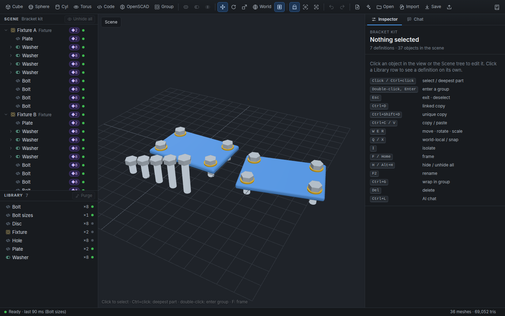

# 3Dica

[](https://github.com/feiteira/3dica/actions/workflows/ci.yml)
[](https://github.com/feiteira/3dica/actions/workflows/pages.yml)
[](LICENSE)

**A browser code-CAD workbench with linked components.**

**[Open the app](https://feiteira.github.io/3dica/)** · **[Read the manual](https://feiteira.github.io/3dica/manual/)**



If you like OpenSCAD or OpenJSCAD but want to point at the thing you are building, 3Dica is for you. Every object is a
named definition with its own code and parameters, written in [JSCAD](https://github.com/jscad/OpenJSCAD.org)
JavaScript or in OpenSCAD. You place definitions in an object tree as **linked instances**: change the definition once
and every copy follows. Click any object in the 3D
view to select it, press <kbd>I</kbd> to isolate it, and move, rotate or scale it with a gizmo. The code stays the source of
truth for shape, and the tree holds placement. Everything runs in your browser. There is no account and no server.

## Features

- **Code objects.** Each object's code is a JSCAD function body. The functions of the main `@jscad/modeling` namespaces
  (`cuboid`, `cylinder`, `union`, `subtract`, `translate`, `extrudeLinear`, …) are in scope by their plain names, and the
  whole library is available as `jscad`. Parameters have defaults, min/max/step hints and per-instance overrides.
- **OpenSCAD objects.** Import `.scad` files (or drop them on the window) and they stay OpenSCAD: a built-in
  interpreter runs them in the browser, following OpenSCAD 2021.01, with no OpenSCAD install. Top-level variables
  become parameters with the Customizer's sliders and drop-downs, `use` / `include` read files attached to the object,
  `echo()` shows in an Output panel, and `part("Name", width = 20)` works both ways. `import()`, `surface()` and fonts
  are not supported (`text()` is approximated).
- **Linked copies.** <kbd>Ctrl</kbd>+<kbd>D</kbd> adds another instance of the *same* definition. A `◆N` badge and a purple
  tint in the view show what is linked. **Make unique** (<kbd>U</kbd>) breaks the link one level deep.
- **Groups and booleans.** Groups are assemblies, or `union` / `subtract` / `intersect` operations. When you select a
  boolean, its operands are shown, with subtract cutters as translucent red.
- **`part('Name', overrides)`.** Code can use another definition's geometry, like calling an OpenSCAD module. A rename
  rewrites the calls, and a delete is refused while code still uses the definition.
- **Click, drill down, isolate.** Click selects the outermost object, <kbd>Ctrl</kbd>+click the deepest part, and
  double-click enters a group. Everything else is ghosted, and Isolate shows a definition alone at the origin.
- **Gizmos and drag and drop.** Move, rotate and scale in world or local space with snapping (1 mm / 15° / 0.1). Drag
  rows in the tree to reparent, and the world position is kept.
- **OpenSCAD conventions.** Millimetres, Z up, and `rotate([x, y, z])` order.
- **Fast and safe evaluation.** Code runs in a Web Worker. Results are cached by content hash, so the 8 bolts of the
  sample share one mesh, and the last good mesh stays on screen while you type. A runaway `while (true)` is stopped
  after 20 s, or about 1 s after you type over it. Geometry that would run the tab out of memory is refused.
- **Files.** Undo and redo, autosave with 5 backups, `.3dica.json` save and open, `.scad` import and export, and
  binary STL export. Opening a file that contains code asks before running it.
- **AI chat.** The Chat tab (<kbd>Ctrl</kbd>+<kbd>L</kbd>) builds and changes parts for you and checks its work in
  screenshots. Bring your own key for Anthropic, OpenAI, OpenRouter, Gemini, Groq, Mistral or DeepSeek, or use a local
  model with Ollama or LM Studio. It runs in the browser, and every change it makes is one undo step.
- **AI assistants.** A local [MCP](https://modelcontextprotocol.io) server lets an assistant such as Claude Code drive a
  running 3Dica and take screenshots.

## Quick start

You need [Node.js](https://nodejs.org) 20.19 or newer (22 LTS recommended) and git.

```sh
git clone https://github.com/feiteira/3dica.git
cd 3dica
npm ci
npm run dev
```

Open <http://localhost:5173>. Add `?fresh` to the URL to start from the sample project and ignore the autosave.

New to the app? Start with [Getting started](https://feiteira.github.io/3dica/manual/guide/getting-started.html) and the
[tutorials](https://feiteira.github.io/3dica/manual/tutorials/first-part.html) in the manual.

## AI chat

The right column has two tabs: **Inspector** and **Chat**. In the Chat tab you ask an assistant for a part or a change,
and it works on the open project with the same tools as the MCP server below: it reads the scene and the code, creates
and edits objects, and takes screenshots to check what it built. Each change is one undo step labelled `AI: …`, and it
asks before it replaces the project.

The chat runs entirely in your browser, also on the hosted app. You paste your own API key (Anthropic, OpenAI,
OpenRouter, Google Gemini, Groq, Mistral, DeepSeek) or point it at Ollama, LM Studio or any OpenAI-compatible server.
The key stays in your browser and goes only to that provider; 3Dica has no server. Setup, privacy and costs are in the
manual: [AI chat](https://feiteira.github.io/3dica/manual/guide/ai-chat.html).

## Use it with an AI assistant (MCP)

`mcp/server.mjs` is a [Model Context Protocol](https://modelcontextprotocol.io) server for a 3Dica that runs on your own
machine. An assistant such as Claude Code can use it to read and change the open project and to take screenshots of the
view. It is opt-in, and the bridge between the server and the browser tab listens on `localhost` only.

The repository includes a `.mcp.json`, so Claude Code offers the server when you open this folder. To register it by
hand:

```sh
claude mcp add 3dica -- node /path/to/3dica/mcp/server.mjs
```

Setup, the list of tools and the security notes are in the manual:
[AI assistants (MCP)](https://feiteira.github.io/3dica/manual/guide/mcp.html).

## Scripts

| Script | What it does |
|---|---|
| `npm run dev` | Vite dev server on <http://localhost:5173> |
| `npm run build` | Type-check, then build the app into `dist/` |
| `npm run preview` | Serve the production build on <http://localhost:4173> |
| `npm test` | Unit tests (vitest, Node environment) |
| `npm run test:e2e` | Playwright end-to-end tests against the dev server |
| `npm run test:e2e:preview` | Production build plus `vite preview`, then the same end-to-end tests |
| `npm run typecheck` | `tsc` in strict mode |
| `npm run docs:dev` | The manual (VitePress) with live reload on <http://localhost:5180/3dica/manual/> |
| `npm run docs:build` | Build the manual into `dist/manual/` |
| `npm run docs:shots` | Regenerate the manual's screenshots in `docs/public/shots/` (Playwright, own dev server on port 5721) |
| `npm run build:site` | `build` and then `docs:build`: the whole GitHub Pages site in `dist/` |
| `npm run mcp` | Start the MCP server (`mcp/server.mjs`) |

`npm run test:watch`, `npm run docs:preview` and `npm run test:all` (typecheck, unit and e2e) are there too.

## Testing

```sh
npm run typecheck
npm test
npx playwright install chromium   # once per machine: the browser build that matches @playwright/test
npm run test:e2e
```

- `npx playwright install chromium` is needed once on a new machine. On a fresh Linux box, use
  `npx playwright install --with-deps chromium` to get the system libraries too.
- Keep `@playwright/test` at the exact version in `package.json`. Each Playwright release expects its own browser build.
- `PW_PORT=<port>` runs the e2e server on another port (the defaults are 5173 for dev and 4173 for preview).
- Pages expose a small test API as `window.__3dica` (`ready`, `idle()`, `stats()`, `defStatus(name)`, `objectPixels()`,
  …). See `src/main.ts`. The URL parameter `?evalTimeout=<ms>` shortens the runaway-code timeout.

## Project layout

```text
src/
  core/      pure logic: types, graph expansion, ops, hashing, eval specs, selection rules (unit-tested)
  openscad/  the OpenSCAD interpreter and geometry builder (contract: types.ts)
  state/     store with undo, clipboard, autosave, other-tab detection
  eval/      worker protocol, engine, worker, client, mesh cache
  view/      three.js viewport, scene sync, materials, picking, gizmo
  ui/        panels, code editor, shortcuts, the Chat tab (chat*.ts)
  app/       commands, controller and the cross-layer contract (context.ts)
  io/        downloads, file picking, window drop
  agent/     the in-app AI chat: loop, tools, prompt, settings, provider adapters (contract: types.ts)
  mcp/       the tool handlers (shared with the chat) and the bridge to the MCP server
  main.ts    boot
tests/
  unit/      vitest
  e2e/       Playwright
  docs/      the manual's screenshot generator (npm run docs:shots)
docs/        the manual (VitePress); docs/design/ holds the historical v0.1 design spec
mcp/         the local MCP server
shared/      the tool catalog and model briefing shared by the MCP server and the in-app chat
public/      static files (favicon)
```

`src/app/context.ts` is the best place to start reading the code. The
[architecture page](https://feiteira.github.io/3dica/manual/dev/architecture.html) explains how the pieces fit together.
`docs/design/spec-v0.1.md` is the original design spec. The `§` references in code comments point to its sections, and
where it and the code differ, the code wins.

## Contributing

Bug reports, ideas and pull requests are welcome. Read [CONTRIBUTING.md](CONTRIBUTING.md) first. To report a security
issue, see [SECURITY.md](SECURITY.md).

## License

[MIT](LICENSE) © 2026 The 3Dica authors

## Acknowledgements

3Dica is built on [three.js](https://threejs.org), [JSCAD](https://github.com/jscad/OpenJSCAD.org)
(`@jscad/modeling`, `@jscad/stl-serializer`), [CodeMirror](https://codemirror.net),
[VitePress](https://vitepress.dev), the [MCP TypeScript SDK](https://github.com/modelcontextprotocol/typescript-sdk),
the [Anthropic](https://github.com/anthropics/anthropic-sdk-typescript) and [OpenAI](https://github.com/openai/openai-node)
TypeScript SDKs and [Zod](https://zod.dev),
and it is built and tested with [Vite](https://vite.dev), [Vitest](https://vitest.dev) and
[Playwright](https://playwright.dev). It owes its ideas to [OpenSCAD](https://openscad.org). Its OpenSCAD interpreter is
an independent implementation, written from the OpenSCAD User Manual and checked against the OpenSCAD 2021.01 binary;
it contains no OpenSCAD code.
